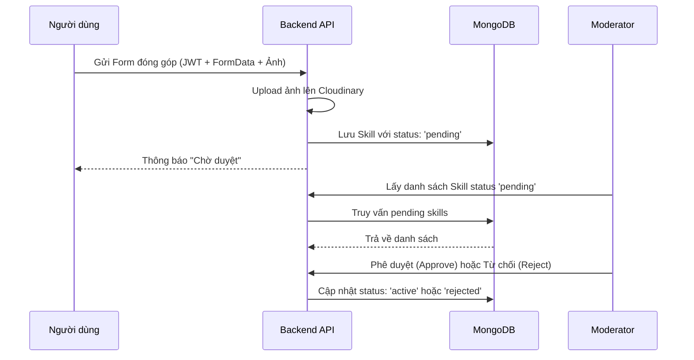
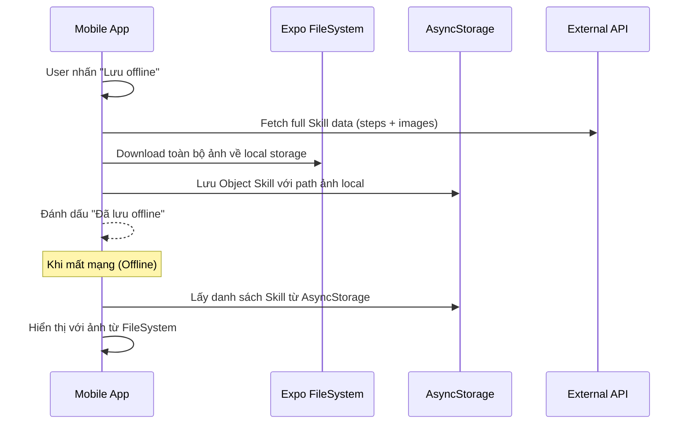

# Tài liệu kỹ thuật: Thư viện Kỹ năng (Skill Library)

Tài liệu này trình bày chi tiết về luồng hoạt động, cấu trúc dữ liệu và các đoạn mã quan trọng của tính năng Thư viện Kỹ năng trong dự án SafeLink.

## 1. Luồng hoạt động (Workflow)

### Luồng Đóng góp & Duyệt (Contribution & Moderation)


### Luồng Offline (Offline Flow)


---

## 2. Cấu trúc dữ liệu (Database Schema)

### Skill Model (Backend)
```javascript
const skillSchema = new mongoose.Schema({
  title: { type: String, required: true },
  summary: String,
  category: { 
    type: String, 
    enum: ['so_cap_cuu', 'pccc', 'thien_tai', 'an_toan_dien', 'tai_nan', 'tam_ly', 'khac'] 
  },
  coverImage: { url: String, publicId: String },
  videoUrl: String, // Link YouTube
  steps: [{
    order: Number,
    title: String,
    content: String,
    images: [{ url: String, publicId: String }] // Ảnh minh họa từng bước
  }],
  difficulty: { type: String, enum: ['co_ban', 'trung_binh', 'nang_cao'] },
  status: { type: String, default: 'pending' }, // 'active', 'pending', 'rejected'
  viewCount: { type: Number, default: 0 }
});
```

---

## 3. Các đoạn mã quan trọng

### Backend: Xử lý Upload đa phương tiện (Middleware)
Sử dụng Multer để xử lý đồng thời ảnh bìa và các ảnh minh họa từng bước.
```javascript
export const uploadSkillMedia = upload.fields([
  { name: "coverImage", maxCount: 1 },
  { name: "stepImages", maxCount: 30 }, // Tối đa 30 ảnh cho tất cả các bước
]);
```

### Frontend: Download ảnh về máy (Offline Storage)
Sử dụng `expo-file-system` để lưu trữ ảnh lâu dài.
```typescript
const downloadImageToLocal = async (remoteUrl: string): Promise<string> => {
  const filename = remoteUrl.split('/').pop();
  const fileUri = `${SKILLS_IMG_DIR}${filename}`;
  
  const fileInfo = await FileSystem.getInfoAsync(fileUri);
  if (!fileInfo.exists) {
    await FileSystem.downloadAsync(remoteUrl, fileUri);
  }
  return fileUri; // Trả về đường dẫn local
};
```

### Frontend: Player Video YouTube (WebView)
Chuyển đổi URL YouTube thường sang dạng Embed để hiển thị trong App.
```typescript
function getYouTubeEmbedUrl(url?: string): string | null {
  if (!url) return null;
  // Regex hoặc URL parser để lấy videoID
  // Trả về: https://www.youtube.com/embed/{videoId}
}

// Render component
<WebView
  source={{ uri: embedUrl }}
  style={styles.video}
  allowsInlineMediaPlayback
/>
```

---

## 4. API Endpoints

- `GET /api/skills`: Lấy danh sách kỹ năng (Public, Cacheable).
- `GET /api/skills/:id`: Chi tiết kỹ năng.
- `POST /api/skills/contribute`: Người dùng đóng góp (Cần Login).
- `GET /api/skills/pending`: Lấy danh sách chờ duyệt (Moderator).
- `PATCH /api/skills/:id/review`: Duyệt hoặc từ chối kỹ năng.

---

## 5. Lưu ý kỹ thuật
- **Thứ tự Route**: Luôn đặt `/contribute` và `/pending` trước `/:id` để tránh ExpressJS nhận nhầm string làm ID.
- **Dung lượng**: Khi xóa kỹ năng đã lưu offline, hệ thống sẽ tự động tìm và xóa các file ảnh tương ứng trong `FileSystem` để giải phóng bộ nhớ.
- **Video**: Tính năng Offline hiện tại chỉ hỗ trợ nội dung chữ và ảnh, không hỗ trợ tải Video về máy để đảm bảo tốc độ và dung lượng.
