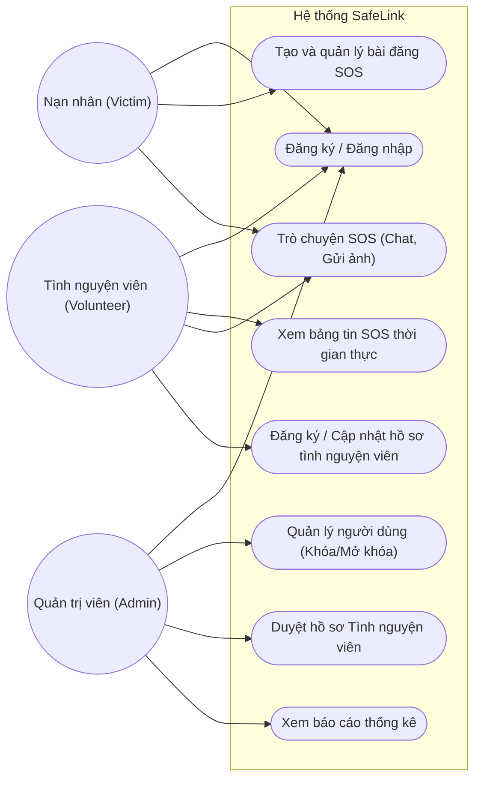

# Tài liệu Đặc tả Use Case - Dự án SafeLink

## 1. Sơ đồ Use Case Hệ thống

---

## 2. Danh sách các Actor

| STT | Tên Actor | Mô tả |
|---|---|---|
| 1 | **Nạn nhân (Victim)** | Là người dùng sử dụng ứng dụng di động để yêu cầu sự trợ giúp khi gặp sự cố, thiên tai hoặc tai nạn. Họ có thể tạo các bài đăng SOS, chia sẻ vị trí hiện tại, gửi hình ảnh tình trạng và trò chuyện trực tiếp với người cứu hộ để nhận được hướng dẫn hoặc sự trợ giúp kịp thời. |
| 2 | **Tình nguyện viên (Volunteer)** | Là người dùng có chuyên môn, kỹ năng y tế hoặc khả năng cứu hộ. Sử dụng ứng dụng để tiếp nhận thông tin SOS, theo dõi bảng tin cứu trợ thời gian thực và liên hệ/trợ giúp nạn nhân. Họ cần cung cấp hồ sơ chuyên môn để hệ thống kiểm duyệt trước khi được công nhận. |
| 3 | **Quản trị viên (Admin)** | Là người quản lý và điều hành toàn bộ hệ thống thông qua giao diện Web (AdminWeb). Có quyền cao nhất trong việc kiểm duyệt nội dung, khóa tài khoản vi phạm (Ban accounts), duyệt hồ sơ tình nguyện viên, và theo dõi các chỉ số thống kê của nền tảng. |

---

## 3. Bảng Use Case theo loại người dùng và chức năng

### 3.1. Nhóm chức năng chung
| Mã UC | Tên Use Case | Actor thực hiện | Mô tả ngắn gọn |
|---|---|---|---|
| UC-G01 | Đăng ký tài khoản | Nạn nhân, TNV | Tạo tài khoản mới trên hệ thống qua Mobile App |
| UC-G02 | Đăng nhập | Nạn nhân, TNV, Admin | Truy cập vào hệ thống để sử dụng các chức năng |
| UC-G03 | Cập nhật thông tin cá nhân | Nạn nhân, TNV | Cập nhật avatar, số điện thoại, thông tin liên lạc... |

### 3.2. Chức năng của Nạn nhân (Victim)
| Mã UC | Tên Use Case | Actor thực hiện | Mô tả ngắn gọn |
|---|---|---|---|
| UC-V01 | Tạo tín hiệu/Bài đăng SOS | Nạn nhân | Gửi yêu cầu cứu trợ khẩn cấp kèm vị trí, hình ảnh, mô tả |
| UC-V02 | Quản lý bài đăng SOS | Nạn nhân | Cập nhật trạng thái (đã được cứu), chỉnh sửa hoặc xóa bài |
| UC-V03 | Đánh giá Tình nguyện viên | Nạn nhân | Gửi phản hồi, đánh giá sau khi quá trình cứu trợ kết thúc |

### 3.3. Chức năng của Tình nguyện viên (Volunteer)
| Mã UC | Tên Use Case | Actor thực hiện | Mô tả ngắn gọn |
|---|---|---|---|
| UC-T01 | Đăng ký làm Tình nguyện viên | TNV | Nộp hồ sơ xét duyệt (kỹ năng, chứng chỉ, mô tả, lệ phí...) |
| UC-T02 | Cập nhật hồ sơ chuyên môn | TNV | Chỉnh sửa thông tin chuyên môn sau khi đã được duyệt |
| UC-T03 | Xem bảng tin SOS | TNV | Theo dõi danh sách bài đăng cứu trợ được cập nhật realtime |
| UC-T04 | Nhận ca cứu trợ | TNV | Xác nhận tiến hành trợ giúp cho một bài đăng SOS cụ thể |

### 3.4. Chức năng Trò chuyện (Chat)
| Mã UC | Tên Use Case | Actor thực hiện | Mô tả ngắn gọn |
|---|---|---|---|
| UC-C01 | Trò chuyện trực tuyến (Chat) | Nạn nhân, TNV | Gửi tin nhắn văn bản, hướng dẫn sơ cứu từ xa |
| UC-C02 | Gửi hình ảnh qua Chat | Nạn nhân, TNV | Gửi ảnh hiện trường hoặc hình ảnh hướng dẫn y tế |
| UC-C03 | Quản lý tin nhắn | Nạn nhân, TNV | Chỉnh sửa, thu hồi (xóa) tin nhắn qua thao tác long-press |

### 3.5. Chức năng của Quản trị viên (Admin)
| Mã UC | Tên Use Case | Actor thực hiện | Mô tả ngắn gọn |
|---|---|---|---|
| UC-A01 | Quản lý tài khoản (Ban/Unban) | Admin | Khóa hoặc mở khóa tài khoản vi phạm, hiển thị lý do cấm |
| UC-A02 | Duyệt hồ sơ Tình nguyện viên | Admin | Xem xét chứng chỉ, phê duyệt hoặc từ chối đăng ký TNV |
| UC-A03 | Quản lý bài đăng SOS | Admin | Ẩn, xóa các bài đăng giả mạo, spam hoặc vi phạm |
| UC-A04 | Xem Dashboard thống kê | Admin | Theo dõi lượng người dùng, bài đăng, tỷ lệ cứu trợ thành công |

---

## 4. Bảng Đặc tả Use Case chi tiết

### 4.1. UC-V01: Tạo tín hiệu / Bài đăng SOS
* **Tên Use Case**: Tạo tín hiệu / Bài đăng SOS
* **Mô tả**: Cho phép Nạn nhân tạo một bài đăng khẩn cấp trên hệ thống để tìm kiếm sự trợ giúp từ Tình nguyện viên. Bài đăng bao gồm thông tin về tình trạng, hình ảnh hiện trường và tọa độ GPS.
* **Trạng thái hệ thống trước (Preconditions)**: Nạn nhân đã đăng nhập vào ứng dụng trên thiết bị di động và cấp quyền truy cập vị trí (GPS).
* **Dòng sự kiện chính (Main flow)**:
  1. Nạn nhân nhấn vào nút "Tạo SOS" trên màn hình chính.
  2. Hệ thống hiển thị form tạo SOS và tự động lấy tọa độ hiện tại.
  3. Nạn nhân nhập mô tả tình trạng và (tùy chọn) đính kèm hình ảnh.
  4. Nạn nhân nhấn nút "Gửi yêu cầu".
  5. Hệ thống kiểm tra dữ liệu hợp lệ, lưu bài đăng vào cơ sở dữ liệu.
  6. Hệ thống broadcast thông báo (real-time) bài đăng mới tới các Tình nguyện viên đang hoạt động gần đó.
* **Dòng sự kiện phụ (Sub flow)**:
  * *(Tại bước 2)* Nếu không thể lấy định vị GPS, hệ thống yêu cầu người dùng nhập vị trí thủ công hoặc bật dịch vụ vị trí.
* **Các yêu cầu đặc biệt**: Nút SOS phải to, rõ ràng, dễ thao tác trong trường hợp hoảng loạn. Tốc độ đồng bộ lên bảng tin phải dưới 2 giây.
* **Trạng thái hệ thống sau (Postconditions)**:
  * **Nếu thành công**: Bài đăng xuất hiện trên Bảng tin SOS và hệ thống ghi nhận trạng thái "Đang chờ cứu trợ".
  * **Nếu thất bại**: Hiển thị thông báo lỗi (VD: Lỗi mạng) và lưu trữ nội dung dạng nháp để gửi lại sau.
* **Điểm mở rộng (Extension points)**: Không có.
* **Tần suất sử dụng**: Cao (khi có thiên tai, sự cố).

### 4.2. UC-T01: Đăng ký làm Tình nguyện viên
* **Tên Use Case**: Đăng ký làm Tình nguyện viên
* **Mô tả**: Người dùng thông thường có nhu cầu tham gia đội ngũ cứu hộ tiến hành nộp hồ sơ, giấy tờ chứng nhận y tế/kỹ năng để Admin phê duyệt.
* **Trạng thái hệ thống trước (Preconditions)**: Người dùng đã có tài khoản nền tảng và đang đăng nhập trên Mobile App. Tài khoản chưa từng bị cấm (Ban).
* **Dòng sự kiện chính (Main flow)**:
  1. Người dùng vào mục "Trở thành Tình nguyện viên".
  2. Hệ thống hiển thị biểu mẫu đăng ký.
  3. Người dùng điền thông tin: Kỹ năng chuyên môn, kinh nghiệm, thông tin liên lạc, tải lên hình ảnh chứng chỉ và mô tả bản thân.
  4. Người dùng nhấn "Nộp hồ sơ".
  5. Hệ thống lưu hồ sơ với trạng thái "Chờ duyệt" (Pending) và gửi thông báo đến Admin.
* **Dòng sự kiện phụ (Sub flow)**:
  * *(Tại bước 1)* Nếu người dùng đã là TNV, hệ thống chuyển hướng sang màn hình "Cập nhật hồ sơ chuyên môn" (UC-T02).
* **Các yêu cầu đặc biệt**: Các file ảnh tải lên phải đúng định dạng và không vượt quá dung lượng cho phép.
* **Trạng thái hệ thống sau (Postconditions)**:
  * **Nếu thành công**: Hồ sơ chuyển sang trạng thái chờ duyệt, người dùng nhận được thông báo hệ thống đã tiếp nhận.
  * **Nếu thất bại**: Thông báo nguyên nhân lỗi (thiếu trường bắt buộc, ảnh quá lớn).
* **Điểm mở rộng (Extension points)**: Cập nhật hồ sơ chuyên môn (UC-T02).
* **Tần suất sử dụng**: Trung bình.

### 4.3. UC-C01: Trò chuyện trực tuyến (Chat SOS)
* **Tên Use Case**: Trò chuyện trực tuyến (Chat SOS)
* **Mô tả**: Nạn nhân và Tình nguyện viên trao đổi thông tin, hình ảnh qua hệ thống nhắn tin realtime để hướng dẫn sơ cứu hoặc xác định tình hình. Có hỗ trợ thu hồi/xóa tin nhắn qua thao tác long-press.
* **Trạng thái hệ thống trước (Preconditions)**: Nạn nhân và Tình nguyện viên đều đang đăng nhập, Tình nguyện viên đã tiếp nhận ca SOS của Nạn nhân.
* **Dòng sự kiện chính (Main flow)**:
  1. Một trong hai người truy cập vào phòng chat của ca cứu trợ.
  2. Người dùng nhập nội dung tin nhắn văn bản hoặc chọn ảnh cần gửi.
  3. Nhấn nút "Gửi".
  4. Hệ thống (thông qua WebSocket/Socket.IO) ngay lập tức đẩy tin nhắn tới màn hình người nhận.
  5. Người nhận đọc tin nhắn (hiển thị trạng thái "Đã xem" nếu cần thiết).
* **Dòng sự kiện phụ (Sub flow)**:
  * **Chỉnh sửa/Xóa tin nhắn**: Người dùng nhấn giữ (long-press) vào tin nhắn của mình. Hệ thống hiện menu [Chỉnh sửa / Thu hồi]. Nếu chọn Thu hồi, hệ thống xóa tin nhắn ở cả 2 phía và hiển thị dòng chữ "Tin nhắn đã bị thu hồi".
* **Các yêu cầu đặc biệt**: Giao tiếp bắt buộc phải diễn ra theo thời gian thực (real-time). Yêu cầu duy trì kết nối WebSocket ổn định.
* **Trạng thái hệ thống sau (Postconditions)**:
  * **Nếu thành công**: Tin nhắn được lưu vào Database và hiển thị đầy đủ trên màn hình của hai bên.
  * **Nếu thất bại**: Hiển thị biểu tượng cảnh báo "Không thể gửi tin nhắn" bên cạnh dòng tin nhắn lỗi.
* **Điểm mở rộng (Extension points)**: Gửi hình ảnh (UC-C02), Quản lý tin nhắn (UC-C03).
* **Tần suất sử dụng**: Rất cao.

### 4.4. UC-A01: Quản lý tài khoản (Ban/Unban)
* **Tên Use Case**: Quản lý tài khoản (Ban/Unban)
* **Mô tả**: Quản trị viên khóa tài khoản của người dùng vi phạm quy tắc cộng đồng (spam SOS, giả mạo...) và cung cấp lý do, thời gian khóa. Mobile App sẽ bắt lỗi HTTP 403 để hiện Pop-up thông báo nếu người dùng bị khóa cố gắng đăng nhập.
* **Trạng thái hệ thống trước (Preconditions)**: Quản trị viên đã đăng nhập vào AdminWeb với quyền Admin.
* **Dòng sự kiện chính (Main flow)**:
  1. Quản trị viên truy cập mục "Quản lý Người dùng".
  2. Tìm kiếm và chọn tài khoản cần xử lý.
  3. Nhấn nút "Khóa tài khoản" (Ban).
  4. Form hiện ra, Admin nhập lý do khóa (`banReason`) và thời hạn khóa (`banExpiresAt`).
  5. Xác nhận thao tác.
  6. Hệ thống vô hiệu hóa token của người dùng đó ngay lập tức và cập nhật trạng thái trong Database.
* **Dòng sự kiện phụ (Sub flow)**:
  * Mở khóa tài khoản (Unban): Chọn người dùng đang bị khóa, nhấn "Mở khóa", hệ thống cho phép tài khoản hoạt động lại bình thường.
* **Các yêu cầu đặc biệt**: Ngay sau khi bị cấm, mọi API request từ thiết bị của người dùng vi phạm sẽ bị trả về mã lỗi 403. Mobile App cần hiển thị đúng Modal có lý do cấm.
* **Trạng thái hệ thống sau (Postconditions)**:
  * **Nếu thành công**: Trạng thái tài khoản đổi thành "Banned".
  * **Nếu thất bại**: Hệ thống báo lỗi xử lý.
* **Điểm mở rộng (Extension points)**: Không có.
* **Tần suất sử dụng**: Thấp đến trung bình.

### 4.5. UC-A02: Duyệt hồ sơ Tình nguyện viên
* **Tên Use Case**: Duyệt hồ sơ Tình nguyện viên
* **Mô tả**: Admin xem xét, đánh giá hồ sơ đăng ký của người dùng để phê duyệt họ trở thành Tình nguyện viên chính thức.
* **Trạng thái hệ thống trước (Preconditions)**: Có ít nhất một hồ sơ TNV đang ở trạng thái chờ duyệt. Admin đã đăng nhập vào AdminWeb.
* **Dòng sự kiện chính (Main flow)**:
  1. Admin mở danh sách "Hồ sơ xét duyệt".
  2. Chọn một hồ sơ cụ thể để xem chi tiết (chứng chỉ, kinh nghiệm, thông tin cá nhân).
  3. Đánh giá tính xác thực của thông tin.
  4. Nhấn nút "Phê duyệt" (Approve) hoặc "Từ chối" (Reject).
  5. Hệ thống cập nhật Role của người dùng (nếu được duyệt thành Volunteer) và gửi thông báo kết quả cho người dùng.
* **Dòng sự kiện phụ (Sub flow)**:
  * Nếu chọn "Từ chối", Admin cần nhập lý do từ chối để người dùng có thể bổ sung hồ sơ.
* **Các yêu cầu đặc biệt**: Giao diện duyệt cần hiển thị to và rõ các hình ảnh chứng chỉ y tế/kỹ năng để Admin dễ dàng quan sát.
* **Trạng thái hệ thống sau (Postconditions)**:
  * **Nếu thành công**: Trạng thái hồ sơ được cập nhật (Approved / Rejected), quyền hạn người dùng thay đổi tương ứng.
  * **Nếu thất bại**: Hệ thống báo lỗi kết nối DB.
* **Điểm mở rộng (Extension points)**: Không có.
* **Tần suất sử dụng**: Trung bình.
